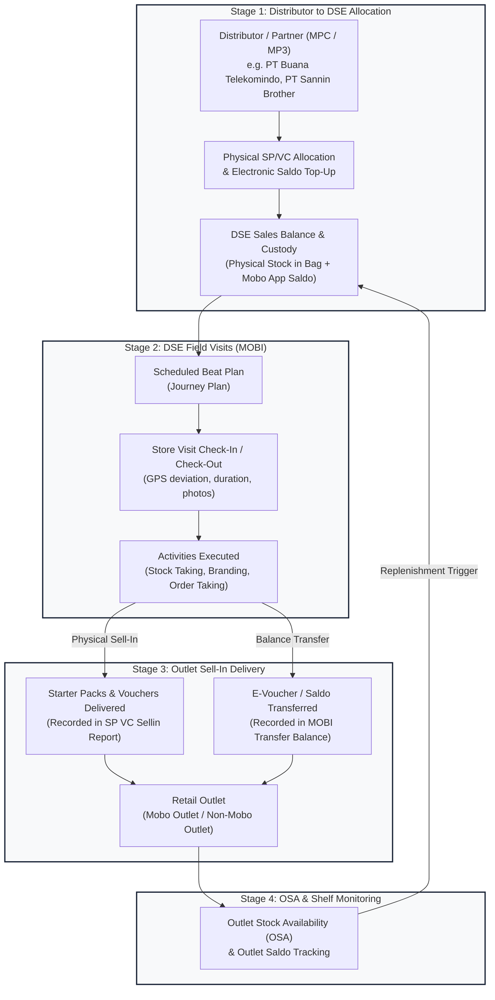
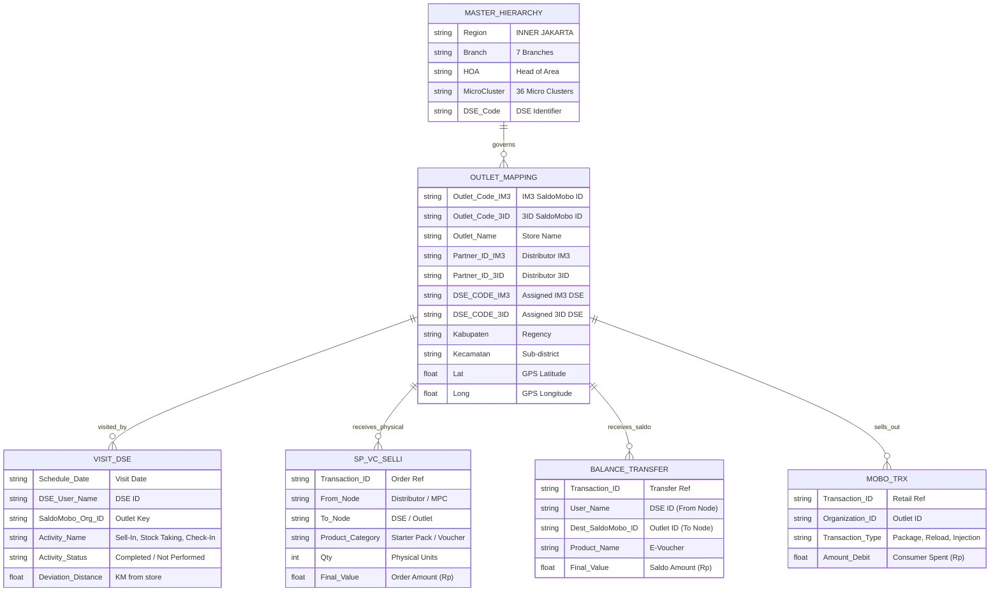

# Technical & Business Data Assessment: Phase 1 Sell-In & Supply Flow

> [!IMPORTANT]
> **Assessment Scope & Directive**: In accordance with user guidance, this assessment establishes the technical and architectural mapping of all available datasets in `raw/` **before** committing any changes into the application code. Phase 1 is strictly focused on the **Sell-In flow**: how stock and balance flow from **Distributor $\rightarrow$ DSE / Sales Balance $\rightarrow$ DSE Field Visits $\rightarrow$ Outlet Sell-In (Starter Packs, Vouchers, Electronic Balance) $\rightarrow$ OSA (Outlet Stock Availability)**.

---

## 1. Raw Dataset Inventory & Architecture

The workspace contains five distinct raw data domains covering operational activity from **01-Oct-2026 to 11-Oct-2026** across **Inner Jakarta** and Greater Jakarta Raya:

```
Supply Demand Monitoring/
├── raw/
│   ├── SP VC Sellin/                 # Physical Distribution (Starter Packs & Vouchers Sell-In)
│   ├── MOBI TRansfer Balance/       # Electronic Balance Transfers (E-Voucher / Saldo to Outlets)
│   ├── MOBI VISIT DSE/              # DSE Journey Plans & Field Visits (817k+ activity rows)
│   ├── Outlet & Mapping/            # Master Outlet, DSE, and Territory Mapping Catalogues
│   └── MOBO TRANSACTION DETAILS/   # Retail Activation & Consumer Demand (Sell-Out Proxy)
├── docs/
│   └── MASTER DSE Hirarki.xlsx     # Governed Master DSE & Territory Hierarchy
└── Performance_Sell_In_GA_Dashboard(2).html  # Reference Single-Page Application
```

### Table Inventory Matrix

| Directory / File | Format & Size | Temporal Window | Grain (Row Level) | Volume | Primary Business Role |
| :--- | :--- | :--- | :--- | :---: | :--- |
| **`SP VC Sellin/`**<br>`3ID Physical_Distribution...csv`<br>`IM3 Physical_Distribution...csv` | Pipe-delimited CSV<br>~2.6 MB | 01–11 Oct 2026 | Transaction per Order / Product Line | 811 rows (3ID)<br>3,848 rows (IM3) | **Physical Supply Sell-In**: Physical Starter Packs (SP) and Vouchers (VC) moving from Distributors/MPCs to DSEs and Outlets. |
| **`MOBI TRansfer Balance/`**<br>`3ID_balance...csv`<br>`IM3_balance...csv` | Pipe-delimited CSV<br>~7.0 MB | 01–11 Oct 2026 | Transaction per Balance Transfer | 2,213 rows (3ID)<br>10,547 rows (IM3) | **Electronic Supply Sell-In**: Balance / Saldo / E-Voucher injected by DSEs/Canvassers into Retail Outlets. |
| **`MOBI VISIT DSE/`**<br>`3id_visit_dse...zip`<br>`im3_visit_dse...zip` | Zip containing Pipe-delimited CSV<br>~350 MB uncompressed | 01–11 Oct 2026 | Scheduled Beat Plan Activity per Visit | 276,172 rows (3ID)<br>541,263 rows (IM3) | **DSE Execution & Field Visits**: Journey plans, check-in/out timestamps, GPS coordinates, visit durations, stock checks, and sales activities. |
| **`Outlet & Mapping/`**<br>`Data_Mapping_Update - 2610091600.xlsb`<br>`adhoc_outlet_im3_3id_data_gcp.xlsb` | Binary Excel (XLSB)<br>~2.1 MB | Current Master Snapshot | 1 row per physical Retail Outlet | **14,695 outlets** (Master)<br>35,804 records (GCP adhoc) | **Master Topology / Bridge**: Maps Outlets to DSEs, Partners (Distributors), Micro Clusters, Branches, and GPS Lat/Long. |
| **`MOBO TRANSACTION DETAILS/`**<br>`87136690_Transaction Detail...` (3 CSVs) | Comma-delimited CSV<br>~112 MB | 01–11 Oct 2026 | Consumer / Retail Transaction | 250k+ transactions | **Downstream Demand**: Consumer activations, reloads, data package purchases (Sell-Out). |

---

## 2. End-to-End Sell-In Pipeline & Flow Analysis

The user defined the Phase 1 business logic as a sequential 4-stage pipeline:



---

## 3. Detailed Data Assessment per Pipeline Stage

### Stage 1: Distributor Fill-In to DSE / Sales Balance

#### Business Definition
The Distributor (Main Partner / MPC) receives bulk stock from Indosat Ooredoo Hutchison and assigns/distributes it downward into:
1. Sub-distribution points / Hubs (MP3 / Branch stockrooms).
2. DSE / Canvasser bags (physical inventory) and DSE MOBI wallets (electronic saldo).

#### Data Observations in `raw/SP VC Sellin/`
Analysis reveals a 3-tier distribution hierarchy present in the transaction rows:
- **Tier 1 (Main MPC $\rightarrow$ Sub-stock MP3)**:
  - Example: `PT BUANA TELEKOMINDO JCN PUSAT` (From Node: `MPC - OWNER_PT-JAKARTA PUSAT_968839`) transfers **1,970 starter packs** to `PT BUANA TELEKOMINDO_TANAH ABANG_MP3` (To Node: `MPC - OWNER_PT-TANAH ABANG_1389376`).
- **Tier 2 (MPC / MP3 $\rightarrow$ DSE / Canvasser Allocation)**:
  - Example: `PT. Elkomindo Mitra Mandiri` transfers stock to `Canvasser_PT-CIBARUSAH_1389836` (Product: `SP FWA Nasional`, Qty: 10 units).
  - Example: `PT SAKALAGUNA CIKAMPEK_MPTHREE` transfers stock to `Canvasser_PT-WEST CIKAMPEK_1390599` (Product: `VOUCHER PHYSICAL BLANK 3IN1 JABODETABEK`).
- **Tier 3 (Canvasser / DSE $\rightarrow$ Outlet)**:
  - Example: `Canvasser_PT-PASAR MINGGU_1390604` (DSE `26130510043ID`) delivers physical stock to `ZDN TRANSF` (Outlet `00264848`).

#### Key Distributor Entities Identified in Inner Jakarta
- `PT Buana Telekomindo` (West Jakarta, Central North Jakarta)
- `PT Sannin Brother Megah` (Bekasi, South Jakarta Depok)
- `PT Elkomindo Mitra Mandiri` (Kab Bekasi, Cikarang)
- `Trimindo Jaya Mandiri PT` (East Jakarta)
- `PT Sakalaguna Semesta` (Karawang)
- `Distribusi Voucher Nusantara PT` (Bekasi, Mustika Jaya)

> [!NOTE]
> **Data Gap / Technical Observation on Electronic Balance**:
> In `raw/MOBI TRansfer Balance/`, the current export filter only includes **DSE $\rightarrow$ Outlet** transfers (`FROM NODE` = Canvasser, `DEST_OUTLET TYPE` = Mobo/Non-Mobo Outlet). The upstream transaction where the Distributor injects electronic balance into the DSE's wallet is recorded in the distributor's primary ledger (`MOBO_BALANCE_TRANSFER` or MOBI bulk allocation log). In Phase 1, the DSE balance can be tracked by:
> $$\text{DSE Electronic Sell-In Velocity} = \sum \text{Balance Transferred to Outlets}$$
> and reconciled against DSE starting quota or distributor dispatch ledgers.

---

### Stage 2: DSE Visits & Journey Plans (`raw/MOBI VISIT DSE/`)

#### Business Definition
DSEs operate on structured beat plans (Journey Plans). A visit is the operational context where Sell-In, physical replenishment, stock checking, and balance transfer occur.

#### Volume & Coverage Metrics (01–11 Oct 2026)
- **3ID**: 276,172 activity records | 416 distinct DSEs | 8,523 unique outlets visited.
- **IM3**: 541,263 activity records | 413 distinct DSEs | 9,832 unique outlets visited.
- **Combined**: **817,435 activity records** across Inner Jakarta.
- **Detailed Deep-Dive Profiling**: See [data_assessment_dse_visit_history.md](./data_assessment_dse_visit_history.md) for full beat plan compliance, duration distributions, GPS proximity, and conversion intersections.

#### Column Dictionary (`Journey Plan Summary Detail Report`)
| Column # | Field Name | Description & Typical Content | Join Key / Relationship |
| :---: | :--- | :--- | :--- |
| 0 | `SCHEDULE DATE` | Scheduled date of visit (e.g. `01-Oct-2026`) | Temporal partition |
| 1 | `DATETIME` | Actual check-in timestamp (e.g. `01-Oct-2026 10:15:22`) | Actual execution time |
| 6 | `BRANCH` | Operational Branch (e.g. `BEKASI`, `EAST JAKARTA`) | Master Hierarchy |
| 7 | `MICRO CLUSTER` | Micro-cluster / DSO (e.g. `MC-CIRACAS`, `MC-CIKARANG`) | Master Hierarchy |
| 11–12 | `BEATPLANID` / `NAME` | Beat plan identifier (e.g. `CSO-SELATAN-02...`) | Routing schedule |
| 14 | `ORG. ID` | Internal Outlet ID in MOBI | `Data_Mapping_Update` |
| 15 | `SALDOMOBO ORG ID` | **Saldo Mobo Outlet ID** (e.g. `00021879`, `138781`) | **Universal Outlet Key** |
| 16 | `ORG NAME` | Registered store name (e.g. `reyvald cell`) | Reference |
| 17 | `OUTLET TYPE` | Category (`retailer`, `traditional`) | Channel classification |
| 20 | `OPERATOR ID` | DSE Operator ID in MOBI | `dse_master_hierarchy.csv` |
| 21 | `USER NAME` | DSE Login ID (e.g. `DSEBEKASI01`, `261305...`) | `dse_master_hierarchy.csv` |
| 22 | `OPERATOR FULL NAME` | Real human name of the DSE | `dse_master_hierarchy.csv` |
| 28 | `ACTIVITY NAME` | Action type performed during the visit | Operational funnel |
| 29 | `ACTIVITY STATUS` | Execution status: `Completed`, `Initiated`, `Not Performed` | Compliance KPI |
| 36 | `DEVIATION DISTANCE` | Distance in KM between outlet GPS and DSE GPS | Geo-compliance audit |
| 38 | `SITE ID` | Cellular Site ID covering the outlet | Network Topology |
| 41 | `VISIT DURATION` | Time spent at the store (MM:SS) | Productivity KPI |

#### Activity Types Discovered in the Raw Logs
The MOBI visit log breaks down visits into specific operational activities:
1. `Check In` & `Check Out`: Timestamp and GPS verification.
2. `Sell In`: Recording of physical orders placed.
3. `Balance Transfer`: Triggering electronic saldo transfer to the store.
4. `Stock Taking` & `View Beat Retailer Stock`: **Direct foundation for OSA**.
5. `5Step Outlet Engagement` & `5Step Outlet Branding`: Merchandising compliance.
6. `Capture Organization Image` & `Validate Geo Location`: Master data verification.

---

### Stage 3: Physical Sell-In (SP/VC) vs Electronic Balance Transfer

#### A. Physical Sell-In (`raw/SP VC Sellin/`)
Contains 4,659 physical distribution transactions for Starter Packs and Vouchers:

| Brand | Top Products | Total Units (01–11 Oct) | Product Category |
| :--- | :--- | :---: | :--- |
| **3ID** | • VOUCHER PHYSICAL BLANK 3IN1 JABODETABEK<br>• BUNDLE PACK KPK REGULER REGION JABODETABEK-Q100<br>• BUNDLING PRODUCT SILVER KARTU PERDANA KOSONG QTY 30<br>• SP HiFi Air 15GB | **88,348 units** | Voucher: 75.7k units<br>Starter Pack: 12.6k units |
| **IM3** | • V0 3in1 JABO_SUK_NewREG<br>• 6G 6G 6G 2hr JAYA<br>• FIS 9GB 2HR JAYA VORI<br>• SP ZERO 0725 JABO SUK DAN CIANJUR<br>• FI 2.5GB/5D NEW GEO JAKARTA RAYA | **219,307 units** | Voucher: 203.2k units<br>Starter Pack: 16.1k units |

#### B. Electronic Balance Transfer (`raw/MOBI TRansfer Balance/`)
Contains 12,760 electronic saldo transfer transactions:

| Metric | 3ID Balance Transfer | IM3 Balance Transfer | Combined Inner Jakarta |
| :--- | :---: | :---: | :---: |
| **Transaction Count** | 2,213 transactions | 10,547 transactions | **12,760 transactions** |
| **Total Value (Rp)** | ~Rp 8.7 Billion | Rp 41.39 Billion | **~Rp 50.1 Billion** |
| **Active Senders (DSEs)** | 256 DSEs | 928 DSEs / Sub-distributors | **1,184 field personnel** |
| **Receiving Outlets** | 1,723 unique outlets | 7,317 unique outlets | **9,040 active outlets** |
| **Average Transfer Value** | ~Rp 3,930,000 / tx | ~Rp 3,924,000 / tx | ~Rp 3,925,000 / tx |
| **Primary Product** | `E-Voucher` | `E-Voucher` | `E-Voucher` |

---

### Stage 4: OSA (Outlet Stock Availability) & Saldo to DSE

#### Business Definition
OSA measures whether an outlet has adequate inventory of Starter Packs, Vouchers, and Mobo Saldo to serve consumer demand without stockout.

#### Data Availability & Mapping
1. **Outlet Stock Availability (Physical)**:
   - Captured in `raw/MOBI VISIT DSE/` under activity `Stock Taking` and `View Beat Retailer Stock`.
   - Reconciled against cumulative `SP VC Sellin` deliveries minus `MOBO TRANSACTION DETAILS` activations.
2. **Outlet Saldo / Balance Availability**:
   - Every transaction in `raw/MOBI TRansfer Balance/` logs the destination outlet's `DEST_SALDOMOBO_ID` and `DEST_OUTLET TYPE` (`Mobo Outlet` vs `Non Mobo Outlet`).
   - The outlet balance reflects recent top-ups delivered by the DSE.
3. **DSE Saldo & Fulfillment Ratio**:
   - By matching DSE visits with subsequent balance transfers, the dashboard can compute:
     - **Strike Rate**: $\frac{\text{Outlets Visited with Sell-In}}{\text{Total Outlets Visited}}$
     - **Average Drop Size**: $\frac{\text{Total Sell-In Value}}{\text{Productive Outlets}}$
     - **Balance Fulfillment Lead Time**: Elapsed time from visit check-in to balance transfer.

---

## 4. Master Topology & Bridge (`raw/Outlet & Mapping/`)

The file [`Data_Mapping_Update - 2610091600.xlsb`](file:///Users/shatyaframudia/Documents/Python%20Project/Python%20Project/Supply%20Demand%20Monitoring/raw/Outlet%20&%20Mapping/Data_Mapping_Update%20-%202610091600.xlsb) provides **14,695 governed outlet records** that bind all transactional logs to the organizational hierarchy:



---

## 5. Technical Data Quality & Ingestion Findings

During binary and CSV inspection, several important technical characteristics were identified:

1. **Header Metadata Offsets**:
   - `raw/SP VC Sellin/` and `raw/MOBI TRansfer Balance/` contain 8 to 9 metadata lines before the column header (e.g. `Physical Distribution Summary Report`, `REPORT GENERATED ON...`). Automated parsers must dynamically search for the header token `TRANSACTION DATETIME` rather than assuming fixed line indices.
2. **Delimiters**:
   - `SP VC Sellin`, `MOBI TRansfer Balance`, and `MOBI VISIT DSE` use pipe (`|`) delimiters.
   - `MOBO TRANSACTION DETAILS` uses standard comma (`,`) delimiters with quotes.
   - `Outlet & Mapping` are Excel Binary (`.xlsb`) files containing UTF-16LE shared string tables.
3. **Column Offset Anomaly in 3ID Balance**:
   - In `3ID_balance_01_11_oct_2026.csv`, row 29 contains extra unescaped tokens in the node descriptor, causing trailing columns (`OPERATOR ID`, `DISCOUNT VALUE`, `FINAL VALUE`) to shift. The ingestion pipeline must implement numeric coercion safeguards (e.g. `try float() except fallback to QTY * RATE`).
4. **Visit Sales Recording vs Transaction Logs**:
   - The summary columns `TOTAL SALES SP QTY` and `TOTAL SALES VC QTY` on high-level rows in `Journey_Plan_Summary_Detail_Report` are frequently recorded as `0` because actual transactional delivery is logged in `SP VC Sellin` and `MOBI TRansfer Balance`. Reconciling visits with sales should be done by joining on `(DSE_ID, OUTLET_ID, DATE)`.

---

## 6. Proposed Phase 1 Application Architecture (Next Steps)

Based on this assessment, the Phase 1 application enhancements should be structured into four integrated views:

1. **Distributor Inflow & Allocation View**:
   - Track bulk stock dispatched from Distributors (MPCs) to sub-distributor stockrooms and DSE bags (Physical SP/VC units and electronic balance allocated).
2. **DSE Journey Plan & Visit Execution View**:
   - Monitor daily DSE beat plans: Outlets scheduled vs visited, check-in duration, GPS compliance, and activity execution (`Stock Taking`, `Sell-In`, `Engagement`).
3. **Sell-In Performance View (Physical & Balance)**:
   - Track actual fulfillment:
     - **Physical**: Starter Packs and Vouchers delivered by brand (IM3 vs 3ID), product line, and denomination.
     - **Electronic**: E-Voucher balance transferred by DSE into Mobo and Non-Mobo outlets.
4. **OSA & Outlet Inventory Health View**:
   - Outlet-level view showing current stock cover, recent delivery dates, and stockout risk indicators across the 14,695 mapped outlets.

> [!TIP]
> **Implementation Prerequisite**: A dedicated parser script (e.g. `scripts/process_sellin_pipeline.py`) should be implemented to extract and join these raw files into a compact, pre-aggregated JSON feed for the dashboard without burdening browser memory.
