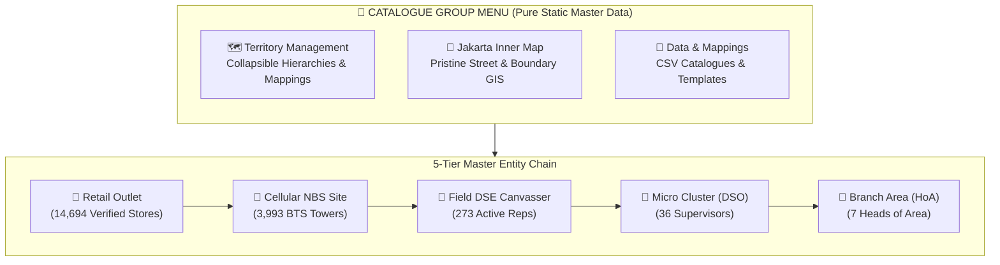

# Jakarta Inner Map & Territory Catalogue Master · Spatial Intelligence

**Dashboard & Catalogue Group Documentation**  
**Project:** Supply & Demand Monitoring (Inner Jakarta)  
**Brand Guide:** Version 2.0 (High Contrast · Red `#EC3013`, Dark Slate `#0F172A`, Sky Blue `#0284C7`, Emerald `#10B981`)  
**Deployment:** 100% Offline Runnable (`website/vendor/leaflet/`) with zero cloud dependencies

---

## 1. Executive Summary & Catalogue Architecture

Per the project directive, the sidebar navigation has been updated to house a dedicated **`CATALOGUE`** group menu containing the pure static master data assets:
- **`🗺️ Territory Management`**: Hierarchical grouping and breakdown (`By HoA`, `By DSO / MC`, `By DSE Canvasser`, `By Kecamatan District`, `By Cellular Site`, and `Full Chain Audit`).
- **`📍 Jakarta Inner Map`**: Spatial GIS visualization of all territory boundaries, cellular network towers, and retail stores with zero-API-key street tiles.
- **`📁 Data & Mappings`**: Static master catalogues, templates, and raw ingestion data dictionary.



> [!IMPORTANT]
> **Pure Static Catalogue Master**: In accordance with user requirements, all dynamic transactional data (**Physical Sell-In SP/VC, Electronic Saldo Transfers, and MOBI DSE Visits**) have been removed from the `CATALOGUE` group views. These operational and execution transactions will be modeled in a separate dedicated downstream flow. The Catalogue group serves strictly as the single source of truth for physical entities, territory borders, network site centroid proximities, and human organizational mapping.

---

## 2. Zero-API-Key Map Tile Architecture

To completely eliminate the `"API Key REQUIRED"` watermark and HTTP 403 errors associated with third-party raster services, the GIS engine has been transitioned to high-detail, unrestricted geographic services:

| Basemap Option | Provider & Endpoint | Visual Purpose | API Key / Token Required? |
| :--- | :--- | :--- | :--- |
| **🗺️ Street & Highway Map** | `server.arcgisonline.com/.../World_Street_Map` | High-detail street network, highways, avenues, neighborhood landmarks, and administrative borders | **None (Zero API Key)** |
| **🏙️ Clean Territory Canvas** | `server.arcgisonline.com/.../Canvas/World_Light_Gray_Base` | Minimalist grayscale styling maximizing the visual contrast of colored territory boundary polygons | **None (Zero API Key)** |
| **🏔️ Topographic & Landscape** | `server.arcgisonline.com/.../World_Topo_Map` | Terrain, elevation contours, rivers, and water bodies across Jabodetabek | **None (Zero API Key)** |
| **🌐 OpenStreetMap Standard** | `{s}.tile.openstreetmap.org` | Global crowd-sourced street-level basemap | **None (Zero API Key)** |
| **🛰️ Satellite Imagery** | `server.arcgisonline.com/.../World_Imagery` | High-resolution aerial and satellite imagery of buildings and physical BTS towers | **None (Zero API Key)** |

```javascript
// High-Reliability Zero-Key Tile Configuration
var tileUrls = {
  esri_street: 'https://server.arcgisonline.com/ArcGIS/rest/services/World_Street_Map/MapServer/tile/{z}/{y}/{x}',
  esri_gray: 'https://server.arcgisonline.com/ArcGIS/rest/services/Canvas/World_Light_Gray_Base/MapServer/tile/{z}/{y}/{x}',
  esri_topo: 'https://server.arcgisonline.com/ArcGIS/rest/services/World_Topo_Map/MapServer/tile/{z}/{y}/{x}',
  osm: 'https://{s}.tile.openstreetmap.org/{z}/{x}/{y}.png',
  esri_sat: 'https://server.arcgisonline.com/ArcGIS/rest/services/World_Imagery/MapServer/tile/{z}/{y}/{x}'
};
```

---

## 3. Spatial Entities & Layers

| Layer | Visual Style | Entity Count | Interactive Profile Drawer Attributes |
| :--- | :--- | :--- | :--- |
| **👑 Area Border** | Red dashed convex hull (`#EC3013`, 3px, 8% fill) | 7 Branches | HoA Leader, total mapped stores, micro cluster count, DSE count, NBS sites, and 1-click drill to table |
| **👔 MC Border** | Blue solid polygon (`#0284C7`, 2px, 12% fill) | 36 Micro Clusters | DSO Supervisor, parent branch & HoA, assigned DSE count, NBS sites count, mapped store count |
| **📍 Kecamatan Border** | Slate dashed polygon (`#64748B`, 1px, 5% fill) | 185 Districts | Kabupaten/Kotamadya, micro cluster, branch, and mapped store count |
| **📡 Cellular NBS Site** | Sky blue circle marker (`#38BDF8`, 5px radius) | 3,993 Towers | Site ID, mapped store count, average BTS distance (km), micro cluster, branch, GPS centroid + Google Maps link |
| **🏪 Retail Outlets** | Telecom blue circle marker (`#0284C7`, 3.5px radius) | 14,694 Stores | Store Name, Store ID, coverage NBS site, distance to BTS (km), DSE canvasser, DSO supervisor, HoA, GPS coordinates + Google Maps link |

---

## 4. High-Performance Hardware-Accelerated Canvas Rendering

Rendering 14,694 individual retail stores and 3,993 cellular sites simultaneously in a standard DOM would degrade rendering performance. The application utilizes Leaflet's HTML5 Canvas renderer:

```javascript
var outletRenderer = L.canvas({ padding: 0.5 });
var cm = L.circleMarker([row[2], row[3]], {
  renderer: outletRenderer,
  radius: 3.5,
  color: '#0F172A',
  weight: 0.8,
  fillColor: '#0284C7',
  fillOpacity: 0.85
}).addTo(map);
```

- **Instant Search & Fly-To**: Instant autocomplete for store name, Store ID, Site ID, DSE name, or Micro Cluster, instantly flying the camera to coordinates at zoom level 15.
- **Scope Focus Dropdown**: One-click framing to any of the 7 Branches or 36 Micro Clusters.
- **Clean Profile Drawer**: Sliding side panel displaying verified metadata and direct deep-links to external Google Maps navigation (`https://maps.google.com/?q={lat},{long}`).
