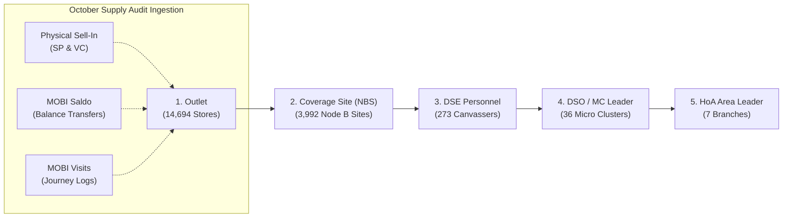

# Governed Territory Management Master Catalogue & Hierarchy Chain

## 1. Executive Summary & Architectural Scope

In accordance with the project directives and Phase 1 Sell-In Pipeline rules, a **confirmed static master catalogue of Territory Management** for Inner Jakarta has been built, reconciled, and embedded into the local offline dashboard.

The master catalogue establishes a fixed, single source of truth across all 5 operational tiers:
$$\mathbf{Outlet} \longrightarrow \mathbf{Site\ (NBS\ Node\ B)} \longrightarrow \mathbf{DSE\ (Field\ Sales)} \longrightarrow \mathbf{DSO\ /\ MC\ Leader} \longrightarrow \mathbf{HoA\ Area\ Leader}$$

Every mapped outlet in the master catalogue is linked to its physical cellular coverage (Node B Site ID and distance in kilometers), accountable field personnel, supervisory leadership, administrative boundaries, and October 2026 supply transactions (Physical Sell-In, MOBI Saldo Transfers, and DSE Visit logs).

---

## 2. Key Master Catalogue Metrics

| Tier Level | Entity | Inner Jakarta Count | Coverage % | Data Source & Governance |
| :--- | :--- | :--- | :--- | :--- |
| **Tier 1** | **Retail Outlets** | **14,694 stores** | 100.0% | Unified master from `Data_Mapping_Update - 2610091600.xlsb` |
| **Tier 2** | **Coverage Sites (NBS)** | **3,992 distinct sites** | **99.82% mapped** | Official cellular tower mapping from `adhoc_outlet_im3_3id_data_gcp.xlsb` & NBS CSV |
| **Tier 3** | **Field DSEs / CSOs** | **273 canvassers** | 100.0% | Field roster from `docs/MASTER DSE Hirarki.xlsx` |
| **Tier 4** | **Micro Clusters & DSOs** | **36 micro-clusters** | 100.0% | Micro cluster roster with designated DSO leaders |
| **Tier 5** | **Branches & HoA Leaders** | **7 branches** | 100.0% | Inner Jakarta regional operations hierarchy |

### Cellular Coverage & Distance Performance
* **Outlets Mapped to NBS Site**: **14,668 stores (99.82%)**
* **Outlets Pending NBS Site**: **26 stores (0.18%)**
* **Average Distance from Cell Site to Outlet**: **0.26 km** (260 meters) across Jabodetabek
* **Distinct Active NBS Sites**: **3,776 sites (94.6% active rate)** receiving recorded supply activity
  - NBS Sites with MOBI Visits: **3,766 sites**
  - NBS Sites with MOBI Saldo Balance: **2,000 sites**
  - NBS Sites with Physical Sell-In (SP/VC): **174 sites**

### Branch Breakdown of NBS Coverage & Activity
| Branch | Mapped NBS Sites | Active NBS Sites | Site Active Rate | Avg Distance to Store | Active Outlets |
| :--- | :--- | :--- | :--- | :--- | :--- |
| **BEKASI** | 481 | 448 | 93.1% | 0.20 km | 1,280 / 1,691 |
| **CENTRAL NORTH JAKARTA** | 497 | 482 | 97.0% | 0.16 km | 1,571 / 1,698 |
| **EAST JAKARTA** | 513 | 481 | 93.8% | 0.18 km | 1,315 / 1,813 |
| **KAB BEKASI** | 723 | 654 | 90.5% | 0.28 km | 1,940 / 2,921 |
| **KARAWANG** | 564 | 553 | 98.0% | 0.37 km | 2,162 / 2,368 |
| **SOUTH JAKARTA DEPOK** | 834 | 788 | 94.5% | 0.36 km | 2,210 / 2,624 |
| **WEST JAKARTA** | 458 | 431 | 94.1% | 0.17 km | 1,290 / 1,553 |

---

## 3. Dedicated Dashboard Tabs & Sub-Views

A dedicated view, **`🗺️ Territory Management`**, has been added to the web application shell ([`website/index.html`](file:///Users/shatyaframudia/Documents/Python%20Project/Python%20Project/Supply%20Demand%20Monitoring/website/index.html)), powered by the offline universal data feed ([`website/data/territory_feed.js`](file:///Users/shatyaframudia/Documents/Python%20Project/Python%20Project/Supply%20Demand%20Monitoring/website/data/territory_feed.js)) and styled per Brand Guide 2.0 ([`website/styles.css`](file:///Users/shatyaframudia/Documents/Python%20Project/Python%20Project/Supply%20Demand%20Monitoring/website/styles.css)).

### Sub-Views Implemented:

1. **🗺️ Chain Explorer (Full Mapping)**:
   - High-density paginated table (50 rows/page) displaying the full chain: **Outlet ID & Name $\rightarrow$ Site NBS & Distance $\rightarrow$ DSE $\rightarrow$ DSO $\rightarrow$ HoA $\rightarrow$ Branch**.
   - Real-time search by Outlet Name, IM3 ID, 3ID ID, Site NBS ID, or DSE.
   - Filter dropdown by Supply Status:
     - `Physical Sell-In (SP / VC)`
     - `Electronic Saldo (MOBI Balance)`
     - `DSE Visited`
     - `Any Supply Transaction`
     - `No Transactions Recorded`
   - Supply status pill badges (`SELL-IN`, `SALDO`, `VISITED`, `NONE`).
   - Click-to-open **Supply Audit Drawer** revealing exact NBS Site ID, distance to BTS (km), GPS coordinates, partner distribution names, total physical pack volumes, electronic balance injected, and last visit timestamps.
   - **Download Filtered CSV**: Generates clean UTF-8 CSV downloads of the current view directly in the browser including Site NBS ID and Distance.

2. **👑 Per HoA (Head of Area / Branch Grouping)**:
   - 7 collapsible/expandable branch cards (South Jakarta Depok, Karawang, Kab Bekasi, West Jakarta, Bekasi, Central North Jakarta, East Jakarta).
   - Each card displays Micro Cluster roster cards with reporting DSOs, active outlet rates, total electronic saldo injected, MOBI visits, and mapped outlet tables.

3. **👔 Per DSO / CSE (Micro Cluster Grouping)**:
   - 36 collapsible/expandable Micro Cluster cards.
   - Displays assigned DSE canvasser roster cards (names, codes, assigned store counts, and injected saldo) plus full outlet tables.

4. **👤 Per DSE (Field Sales Representative Grouping)**:
   - 273 collapsible/expandable DSE cards with 25-group pagination.
   - Shows assigned store count, active outlet %, saldo balance, visit counts, reporting DSO, and assigned store tables.

5. **📍 Per Kecamatan (Administrative District Grouping)**:
   - 171 collapsible/expandable Kecamatan cards with 25-group pagination.
   - Displays covered Desa/Kelurahan breakdown chips and all mapped retail stores.

6. **📡 Per Sites (Cellular NBS Node B Grouping)**:
   - 3,992 collapsible/expandable NBS Site cards with 25-group pagination.
   - Displays average BTS-to-store distance in kilometers, store coverage %, total saldo, and covered stores table.

All grouping views feature bulk `[ ＋ Expand All ]` and `[ － Collapse All ]` toggles, instant search, supply status filters, and click-to-inspect supply audit drawers.

---

## 4. Governed File Assets Generated

| Path | Format | Size | Description |
| :--- | :--- | :--- | :--- |
| [`data/catalogues/territory_management_master.json`](file:///Users/shatyaframudia/Documents/Python%20Project/Python%20Project/Supply%20Demand%20Monitoring/data/catalogues/territory_management_master.json) | JSON | 13.2 MB | Full master catalogue of 14,694 unified outlet records with Site NBS & Distance |
| [`data/catalogues/territory_management_master.csv`](file:///Users/shatyaframudia/Documents/Python%20Project/Python%20Project/Supply%20Demand%20Monitoring/data/catalogues/territory_management_master.csv) | CSV | 4.7 MB | Tabular CSV master with `site_nbs` and `dist_km` for external reporting |
| [`data/catalogues/territory_hierarchy_chain.json`](file:///Users/shatyaframudia/Documents/Python%20Project/Python%20Project/Supply%20Demand%20Monitoring/data/catalogues/territory_hierarchy_chain.json) | JSON | 32 KB | 5-level hierarchy tree (Branch $\rightarrow$ HoA $\rightarrow$ MC $\rightarrow$ DSO $\rightarrow$ DSE) |
| [`website/data/territory_feed.js`](file:///Users/shatyaframudia/Documents/Python%20Project/Python%20Project/Supply%20Demand%20Monitoring/website/data/territory_feed.js) | JS (UMD) | 11.4 MB | High-performance dashboard data feed for browser & Node |
| [`website/data/territory_feed.json`](file:///Users/shatyaframudia/Documents/Python%20Project/Python%20Project/Supply%20Demand%20Monitoring/website/data/territory_feed.json) | JSON | 11.4 MB | Standalone JSON feed mirror |
| [`scripts/build_territory_management_catalogues.py`](file:///Users/shatyaframudia/Documents/Python%20Project/Python%20Project/Supply%20Demand%20Monitoring/scripts/build_territory_management_catalogues.py) | Python | 19 KB | Offline pure-Python MS-XLSB parser and catalogue builder |
